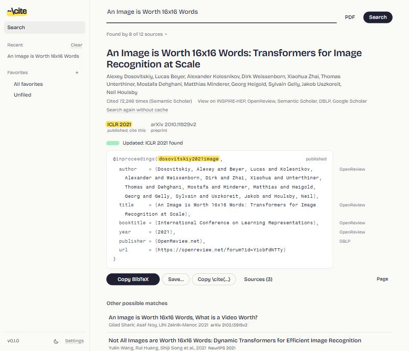
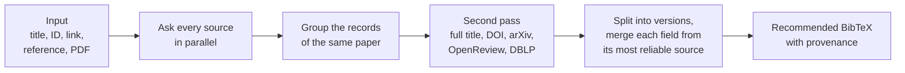

<p align="center">
  
</p>

<p align="center">
  <b>The right BibTeX for any paper, checked against every source.</b>
</p>

<p align="center">
  <a href="https://pypi.org/project/therightbibtex/"></a>
  <a href="https://pypi.org/project/therightbibtex/"></a>
  <a href="https://github.com/marcpinet/therightbibtex/actions/workflows/tests.yml"></a>
  
  <a href="https://github.com/marcpinet/therightbibtex/blob/main/LICENSE"></a>
</p>

<picture>
  <source media="(prefers-color-scheme: dark)" srcset="https://raw.githubusercontent.com/marcpinet/therightbibtex/main/docs/screenshot-dark.jpg">
  
</picture>

## Why

Google Scholar hands you the arXiv preprint of a paper published at ICLR two years ago, cuts the author list at
`and others`, lowercases `BERT` and invents a venue name. Fixing it means opening DBLP, OpenReview and the
proceedings site, one paper at a time.

therightbibtex does that cross-check for you, in a few seconds: it asks every relevant source at once, groups the
versions of the same paper, and gives you the BibTeX of the version you should cite, with the origin of every field.
It runs on your computer, from the terminal or in your browser.

## Install

```bash
pipx install therightbibtex      # or: uv tool install therightbibtex, or: pip install therightbibtex
```

Python 3.10 or newer, on Linux, macOS and Windows.

## Command line

```console
$ therightbibtex "An image is worth 16x16 words"
@inproceedings{dosovitskiy2021image,
  author    = {Dosovitskiy, Alexey and Beyer, Lucas and Kolesnikov, Alexander and Weissenborn, Dirk and ...},
  title     = {An Image is Worth 16x16 Words: Transformers for Image Recognition at Scale},
  booktitle = {International Conference on Learning Representations},
  year      = {2021},
  publisher = {OpenReview.net},
  url       = {https://openreview.net/forum?id=YicbFdNTTy}
}
ICLR 2021 (published), high confidence; other versions: arXiv 2010.11929v2 (--all shows them)
```

The BibTeX goes to stdout and the notes to stderr, so `therightbibtex "..." > paper.bib` or `| pbcopy` just works.

```bash
therightbibtex 2010.11929 --all                 # every version: published, preprint, submission
therightbibtex "https://openreview.net/forum?id=YicbFdNTTy"
therightbibtex paper.pdf                        # title, DOI, arXiv or HAL ID read from the PDF
therightbibtex refs.bib -o refs-checked.bib     # check a whole .bib, citation keys are kept
therightbibtex batch titles.txt                 # one reference per line (or - for stdin)
therightbibtex pick refs.bib -o refs-checked.bib  # same, but asks which one to keep when there are several
therightbibtex "attention is all you need" -s key_style=dblp -s venue_style=short
therightbibtex "..." --json                     # every version and the source of each field
```

`--refresh` skips the local cache, `-q` prints only BibTeX, `-v` logs what each source does.

`pick` only asks when an entry has several possibilities (published version and preprint, other similar papers),
while the next searches keep running: Enter keeps the recommended one, a number picks another, `k` keeps your
entry, `s 2` shows a BibTeX, `a` accepts the recommended one for the rest, `q` keeps the rest as it is.

## Web interface

```bash
therightbibtex serve        # opens http://localhost:8137
```

The same search with live results, and batches: paste several lines or a whole `.bib`, and entries with several
possibilities show their choices right in the list. Plus a library: favorites in colored, nested folders, `.bib` and CSL-JSON
import and export, and one click to re-check every preprint of a folder and upgrade it to its published version,
keeping the citation keys your paper already uses. Light and dark themes, and it works on a phone too:
`--host 0.0.0.0` makes it reachable from your local network, without a password, so only on a network you trust.

## What you can type

| You type | You get |
| --- | --- |
| `When Foundation Models are One-Liners` | the **ICLR 2026** entry from OpenReview (no need for the subtitle) |
| `mTSBench` | the **TMLR 2026** version: found on arXiv, confirmed on OpenReview and DBLP |
| `Atention is all you ned` | **NeurIPS 2017**, after fixing the typos |
| `dosovitskiy image worth words` | an author name and a few title words are enough |
| `2010.11929`, a DOI, an OpenReview or proceedings link | the published version, not only the preprint |
| `hal-03692072`, a HAL link or a PDF with its HAL cover page | the entry with its `hal_id` and `hal_version` |
| a reference copied from a PDF, a BibTeX entry, or the PDF itself | the clean, checked entry |

## Features

- **Published version first.** Preprint, submission and published versions are kept apart, and the one to cite is
  recommended. In the web interface, the entry stays greyed with a highlighted `?` while sources are still answering.
- **Provenance everywhere.** Each field shows where it comes from. Disagreements between sources, retractions and
  suspicious copies (re-uploads, foreign DOIs) are flagged instead of silently merged.
- **BibTeX your way.** Citation key style (`vaswani2017attention`, `Vaswani2017`, DBLP keys), full or short venue
  names, arXiv as `@article` or `@misc`, LaTeX or Unicode accents, protected capitals, max authors.
- **Your own API keys, optional.** Several keys per service: if one is rejected or out of quota, the next one takes over.

## Sources

| Kind | Sources |
| --- | --- |
| DOI registries | Crossref, doi.org, DataCite, OpenAlex |
| Computer science | DBLP, OpenReview, ACL Anthology, official proceedings (NeurIPS, PMLR, CVF, JMLR) |
| Preprints | arXiv, HAL |
| Aggregators | Semantic Scholar, Google Scholar (through SerpAPI) |
| Other fields | Europe PMC, INSPIRE-HEP, zbMATH |

No key is needed. Keys raise the rate limits and enable Google Scholar:

```bash
therightbibtex keys add s2          # Semantic Scholar: https://www.semanticscholar.org/product/api
therightbibtex keys add openalex    # OpenAlex: https://openalex.org/settings/api
therightbibtex keys add serpapi     # Google Scholar through SerpAPI: https://serpapi.com
therightbibtex keys list
```

The key is asked for without echo, checked with the service, then stored in your config file. Keys can also be
managed from the settings of the web interface.

## Configuration

Everything stays in one folder on your computer: `config.json` (settings and keys, readable by you only),
`library.db` (favorites and history), `cache.db` (source answers) and daily backups of the library.

| System | Folder |
| --- | --- |
| Linux | `$XDG_CONFIG_HOME/therightbibtex` (default `~/.config/therightbibtex`) |
| macOS | `~/Library/Application Support/therightbibtex` |
| Windows | `%APPDATA%\therightbibtex` |

Set `THERIGHTBIBTEX_HOME` to use another folder.

```bash
therightbibtex config                       # print config.json
therightbibtex config set key_style dblp
therightbibtex config set contact_email you@example.org
therightbibtex config unset key_style       # back to the default
```

| Setting | Default | Values |
| --- | --- | --- |
| `key_style` | `scholar` | `scholar` (vaswani2017attention), `AuthorYear`, `AuthorYearWord`, `dblp` |
| `venue_style` | `full` | `full`, `short` (ICML), `short_year` (ICML 2021) |
| `arxiv_style` | `article` | `article` (journal = arXiv preprint ...), `misc` (eprint fields) |
| `accents` | `latex` | `latex`, `unicode` |
| `protect_caps` | `true` | wrap acronyms in braces (`{BERT}`) |
| `url` | `auto` | `auto` (only without DOI), `always`, `never` |
| `doi`, `month`, `abstract` | `true`, `false`, `false` | include these fields |
| `hal` | `true` | `hal_id` and `hal_version` of a HAL deposit, as in HAL's own export |
| `max_authors` | `100` | longer lists end with `and others` |
| `contact_email` | none | sent to Crossref and OpenAlex for their faster "polite" pool |
| `port` | `8137` | port of `therightbibtex serve` |
| `scholar_direct` | `false` | query Google Scholar without SerpAPI (see below) |

Google Scholar has no API: without a SerpAPI key it is skipped. `scholar_direct` scrapes it instead, which Google
may block (captcha) and which its terms of service do not allow; it is off unless you turn it on.

## How it works



Records are only grouped when their titles or authors agree, so a wrong identifier from one source cannot drag in
another paper. Answers are cached locally, so a repeated search takes a second or two.

## Privacy and security

Your queries go to the sources above and nowhere else; there is no account, no telemetry, no server of ours. The
web interface listens on `127.0.0.1` only, refuses requests addressed to any other host name (DNS rebinding) and
writes coming from other sites, and runs under a strict Content Security Policy. PDFs are parsed in a separate
process, and API keys are never sent back to the browser.

## Development

```bash
git clone https://github.com/marcpinet/therightbibtex
cd therightbibtex
pip install -e .
python -m unittest discover -s tests
```

The tests are **fully offline**: real searches are recorded once (`tests/record_fixtures.py`) and replayed, so the
whole pipeline is tested against what the sources actually return, edge cases included (short names, typos,
foreign DOIs, dataset records).

```text
therightbibtex/
  cli.py         command line
  web.py         local web server: streamed search, library, exports
  engine.py      search pipeline: phases, grouping, versions, scoring, recommendation
  sources/       one module per source
  bibtex.py      parsing, rendering, citation keys
  venues.py      venue names and abbreviations (NIPS is NeurIPS, ISO 4 forms)
  query.py       what the input is: title, identifiers, reference, BibTeX
  pdfinfo.py     title, DOI, arXiv and HAL ID from a PDF
  config.py      config.json: settings, options, API keys
  store.py       SQLite library: folders, favorites, history
  static/        the web interface: vanilla JS, no build step, self-hosted fonts
tests/           unittest suite and recorded fixtures
```

Releases are automatic: bump `__version__` in `therightbibtex/__init__.py` and push to `main`. The `pypi`
workflow runs the tests, publishes the new version to PyPI and creates the matching GitHub release.

## License

[AGPL-3.0-or-later](LICENSE). © 2026 Marc Pinet.
